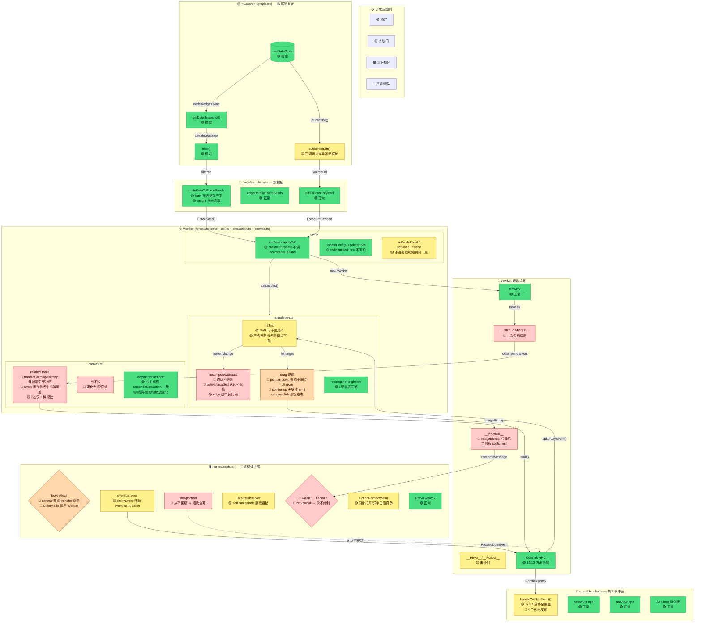

# Force Mode Architecture Audit

## 1. 架构全貌 + 数据管线

---

## 2. Worker 内部渲染管线 + 状态机

```mermaid
flowchart TB
    %% ══════════════════════════════════════════════════════
    %% TICK LOOP: simulation → frame
    %% ══════════════════════════════════════════════════════
    subgraph TICK["⏱️ 每 Tick 渲染循环"]
        direction LR
        ONTICK["d3 onTick<br/>🟢 正常触发"]
        COALESCE["queueMicrotask<br/>合帧<br/>🟢 正常"]
        SCHEDULE["scheduleFrame<br/>🟢 正常"]
    end

    subgraph RENDER_PIPE["🎨 渲染管线"]
        direction TB
        
        BG["1. 背景填充<br/>🟢 正常"]
        GRID["2. 网格线<br/>🟡 gridColor 定义但未绘制"]
        EDGES["3. 画边<br/>🔴 边永远 default 风格<br/>🔴 箭头被节点遮挡<br/>🔴 自环退化为点"]
        NODES["4. 画节点<br/>🟡 7态仅 6 种视觉<br/>🟡 fill 字段从未使用<br/>🟡 label 色不随状态变"]
        TRANSFER["5. transferToImageBitmap()<br/>🔴 每帧清空 OffscreenCanvas<br/>🔴 主线程 ctx2d=null 无法绘制"]
    end

    TICK --> RENDER_PIPE

    %% ══════════════════════════════════════════════════════
    %% UiState 7-state machine
    %% ══════════════════════════════════════════════════════
    subgraph STATE_MACHINE["🧠 UiState 7 态机 (force 独有)"]
        direction LR

        subgraph REACHABLE["✅ 可到达的态"]
            DEFAULt["default<br/>🟢 初始/无选态"]
            HOVER["hover<br/>🟢 悬停"]
            SELECTED["selected<br/>🟡 左键选中断裂<br/>仅右键可达"]
            NEIGHBOR_A["neighborActive<br/>🟢 1度邻居"]
            INACTIVE["inactive<br/>🟡 可达但视觉弱"]
        end

        subgraph DEAD["❌ 死态 (从未赋值)"]
            ACTIVE["active<br/>🔴 与 selected 视觉相同<br/>从未有代码赋值"]
            DISABLED["disabled<br/>🔴 从未有代码赋值"]
        end
    end

    %% ══════════════════════════════════════════════════════
    %% Edge rendering detail
    %% ══════════════════════════════════════════════════════
    subgraph EDGE_DETAIL["🔗 边渲染详情"]
        direction TB
        HIER["hierarchy → 直线<br/>🟢 正常"]
        FLOW_E["flow → 二次贝塞尔<br/>🟢 正常"]
        ASSOC["association → 虚线 6 4<br/>🟢 正常"]
        INTER["interaction → cubic bezier<br/>🟢 正常"]
        BI_E["双向边 → simplebezier + 双箭头<br/>🟡 箭头在节点中心被覆盖"]
        ARROW["drawArrow()<br/>🟡 forward/reverse 方向正确<br/>🔴 画在 (tx,ty) 被节点覆盖"]
        SELFL["自环 source===target<br/>🔴 bezierCurveTo 全等控制点 → 退化为点<br/>🔴 quadratic → 退化直线"]
    end

    %% ══════════════════════════════════════════════════════
    %% Hit-test detail
    %% ══════════════════════════════════════════════════════
    subgraph HIT_DETAIL["🎯 Hit-Test 详情"]
        direction TB
        BRUTE["nodes &lt; 2000: 暴力遍历<br/>🟢 正常"]
        QT["nodes ≥ 2000: d3-quadtree<br/>🟡 严格等距时与暴力结果不同<br/>🟡 NaN 坐标可损坏四叉树"]
        NAN["NaN 坐标<br/>🟡 typeof NaN === 'number' →<br/>穿透 getPositionForView 守卫<br/>🟡 dist=NaN → 永不命中"]
    end

    %% ══════════════════════════════════════════════════════
    %% D3-force config
    %% ══════════════════════════════════════════════════════
    subgraph D3_CONFIG["⚡ d3-force 配置"]
        direction LR
        CFG_BOX["DEFAULT_FORCE_CONFIG<br/>🟡 缺 centerX/centerY<br/>🟡 collisionRadius:0 不可设"]
        ALPHA_BOX["Alpha 控制<br/>🟢 createOrUpdate: alpha(1)<br/>🟢 applyDiff: alphaTarget(0.1)<br/>🟢 updateConfig: alpha(0.3)<br/>🟢 setNodeFixed: alphaTarget(0.3)"]
    end

    %% Styles
    classDef green fill:#4ade80,stroke:#16a34a,color:#052e16,stroke-width:1px
    classDef yellow fill:#fef08a,stroke:#ca8a04,color:#422006,stroke-width:1px
    classDef red fill:#fecaca,stroke:#dc2626,color:#450a0a,stroke-width:1px

    class ONTICK,COALESCE,SCHEDULE,BG,DEFAULt,HOVER,NEIGHBOR_A,HIER,FLOW_E,ASSOC,INTER,BRUTE,ALPHA_BOX green
    class GRID,SELECTED,INACTIVE,BI_E,ARROW,QT,NAN,CFG_BOX yellow
    class EDGES,NODES,TRANSFER,ACTIVE,DISABLED,SELFL red
```

---

## 3. 开发度记分卡

| 模块 | 文件 | 合同 | 功能 | 鲁棒性 | 信号 |
|---|---|---|---|---|---|
| **数据供给** | `graph.tsx` | 🟢 | 🟢 | 🟡 | diff 回调同步抛异常无保护 |
| **编排器** | `ForceGraph.tsx` | — | 🟠 | 🔴 | canvas 双重 transfer 崩溃、僵尸 Worker、订阅泄漏 |
| **事件桥** | `eventHandler.ts` | 🟢 | 🟡 | 🟢 | 17/17 事件全覆盖，4个永不发射 |
| **转换层** | `transform.ts` | 🟢 | 🟡 | 🟡 | NaN 穿透、weight 死代码、semanticColor 死特性 |
| **DOM 事件** | `eventListener.ts` | 🟢 | 🟡 | 🟡 | proxyEvent 浮动 Promise |
| **Worker API** | `api.ts` | 🟢 | 🟢 | 🟡 | createOrUpdate 不调 recomputeUiStates |
| **模拟** | `simulation.ts` | 🟢 | 🟠 | 🟡 | 选态断裂、多选拖拽坍缩、hitTest NaN/四叉树分歧 |
| **画布** | `canvas.ts` | 🔴 | 🔴 | 🟡 | ctx2d=null 管线断裂、箭头隐藏、自环退化 |
| **主题** | `styleConfig.ts` | 🟡 | 🟡 | 🟢 | DEFAULT_FORCE_CONFIG 缺 centerX/Y、active/selected 相同 |

### 问题统计

| 等级 | 数量 | 关键问题 |
|---|---|---|
| 🔴 危急 | 4 | Canvas 渲染管线断裂、视图切换崩溃、StrictMode 僵尸 Worker、Diff 订阅泄漏 |
| 🔴 高 | 12 | 缩放死掉、选态断裂、4事件不发射、7态仅6视觉、边永远default、箭头隐藏、多选拖拽坍缩… |
| 🟡 中 | 9 | proxyEvent Promise 泄漏、NaN 穿透、collisionRadius:0 短路、canvas-init 静默失败… |
| 🟢 低 | 5 | boot timer 泄漏、bitmap 泄漏、无 ErrorBoundary、healthCheck 死代码… |

> **总评：Force 模式处于重度开发阶段，不可用于生产。** Canvas 渲染管线和选态系统是最优先修复项。
