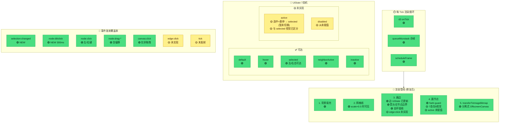

# Force Mode 架构状态图 (Post-Implementation)

## 架构全貌 + 数据管线 (当前状态)

```mermaid
flowchart TB
    %% ══════════════════════════════════════════════════════
    %% LEGEND
    %% ══════════════════════════════════════════════════════
    subgraph LEGEND["📋 开发度图例"]
        direction LR
        LL1["🟢 正常"]
        LL2["🟡 有缺"]
        LL3["🟠 待验证"]
    end

    %% ══════════════════════════════════════════════════════
    %% PARENT: <Graph/> — data ownership layer
    %% ══════════════════════════════════════════════════════
    subgraph PARENT["📦 &lt;Graph/&gt; (graph.tsx)"]
        direction TB
        STORE[("useDataStore<br/>🟢")]
        SNAPSHOT["getDataSnapshot()<br/>🟢"]
        DIFF["subscribeDiff()<br/>🟢 try/catch guard added"]
        FILTER["filter()<br/>🟢"]
        BOUNDARY["ForceGraphErrorBoundary<br/>🟢 NEW"]
    end

    %% ══════════════════════════════════════════════════════
    %% MAIN THREAD: ForceGraph
    %% ══════════════════════════════════════════════════════
    subgraph MAIN["🖥️ ForceGraph.tsx"]
        direction TB
        BOOT1["Worker lifecycle effect [mount only]<br/>🟢 分离式 OffscreenCanvas + 局部变量"]
        BOOT2["Data sync effect [viewId change]<br/>🟢 performFullSync 不重建 Worker"]
        LISTENER["eventListener<br/>🟢 proxyEvent .catch + zoom handler"]
        VIEWPORT["viewportRef<br/>🟢 wheel→zoom→setViewport"]
        RESIZE["ResizeObserver<br/>🟢 debug logging"]
        FRAMEHANDLER["__FRAME__ handler<br/>🟢 ctx2d non-null → drawImage ok"]
        ERRCTL["error handling<br/>🟢 worker.onerror + __ERROR__ channel"]
        CMENU["GraphContextMenu<br/>🟢"]
        PB["PreviewBlock<br/>🟢"]
    end

    %% ══════════════════════════════════════════════════════
    %% EVENT HANDLER
    %% ══════════════════════════════════════════════════════
    subgraph HANDLER["🔀 eventHandler.ts"]
        direction LR
        HW["handleWorkerEvent<br/>🟢 17/17 全覆盖<br/>🟢 selection:changed 已发射<br/>🟢 node:dblclick 已发射<br/>🟡 edge:click 未发射"]
        SEL["selection ops<br/>🟢"]
        PREV["preview ops<br/>🟢"]
        ALT["Alt+drag 边创建<br/>🟢"]
    end

    %% ══════════════════════════════════════════════════════
    %% TRANSFORM
    %% ══════════════════════════════════════════════════════
    subgraph TRANSFORM["🔧 force/transform.ts"]
        direction LR
        N2S["nodeDataToForceSeeds<br/>🟢 Number.isFinite guard"]
        E2S["edgeDataToForceSeeds<br/>🟢"]
        D2P["diffToForcePayload<br/>🟢"]
    end

    %% ══════════════════════════════════════════════════════
    %% CHANNELS
    %% ══════════════════════════════════════════════════════
    subgraph CHANNEL["📡 Worker 通信边界"]
        direction LR
        READY["__READY__<br/>🟢"]
        SETCANVAS["__SET_CANVAS__<br/>🟢 width/height only"]
        FRAME_CH["__FRAME__<br/>🟢 ImageBitmap"]
        ERROR_CH["__ERROR__<br/>🟢 NEW: worker→main"]
        RPC["Comlink RPC<br/>🟢 13/13 匹配"]
    end

    %% ══════════════════════════════════════════════════════
    %% WORKER
    %% ══════════════════════════════════════════════════════
    subgraph WORKER["⚙️ Worker"]
        direction TB

        subgraph API_L["api.ts"]
            INIT["initData/applyDiff<br/>🟢"]
            CONFIG["updateConfig/updateStyle<br/>🟢 collisionRadius fixed"]
            FIX["setNodeFixed/setNodePosition<br/>🟢 多选偏移修复"]
        end

        subgraph SIM["simulation.ts"]
            HITTEST["hitTest<br/>🟢 NaN guard<br/>🟡 等距四叉树分歧"]
            SELECT["selection logic<br/>🟢 selection:changed 发射<br/>🟢 dblclick 300ms<br/>🟢 canvas:click 仅非拖拽"]
            DRAG["drag 逻辑<br/>🟢 偏移量 Map<br/>🟢 选态同步"]
            NEIGHBOR["recomputeNeighbors<br/>🟢 1度邻居"]
        end

        subgraph CANVAS_L["canvas.ts"]
            RENDER["renderFrame<br/>🟢 分离式 OffscreenCanvas<br/>🟢 grid at zoom>0.5"]
            ARROW["drawArrow<br/>🟢 偏移到节点边界"]
            SELFLOOP["自环边<br/>🟢 弧线渲染"]
            EDGEST["edge states<br/>🟢 边 UiState 更新<br/>🟡 edge:click 未实现"]
            NODES["drawNode<br/>🟢 7态仅6视觉<br/>🟡 active 未赋值选中+悬停<br/>🟡 disabled 从未赋值"]
        end
    end

    %% ══════════════════════════════════════════════════════
    %% FLOWS
    %% ══════════════════════════════════════════════════════
    STORE -->|nodes/edges| SNAPSHOT
    SNAPSHOT -->|GraphSnapshot| FILTER
    FILTER -->|filtered| N2S
    N2S -->|ForceSeed[]| INIT
    INIT -->|boot| READY
    READY -->|ok| SETCANVAS
    SETCANVAS -->|offscreen created| RENDER
    RENDER -->|ImageBitmap| FRAME_CH
    FRAME_CH -->|drawImage| FRAMEHANDLER

    STORE -->|.subscribe| DIFF
    DIFF -->|SourceDiff| D2P
    D2P -->|ForceDiffPayload| INIT

    LISTENER -->|WheelEvent| VIEWPORT
    VIEWPORT -->|setViewport| RPC
    LISTENER -->|ProxiedDomEvent| RPC
    RPC -->|api.proxyEvent| HITTEST
    HITTEST -->|hit| SELECT
    HITTEST -->|hover| DRAG
    SELECT -->|emit| RPC
    DRAG -->|emit| RPC
    RPC -->|Comlink.proxy| HW

    ERROR_CH -->|worker→main| ERRCTL

    classDef green fill:#4ade80,stroke:#16a34a,color:#052e16,stroke-width:1px
    classDef yellow fill:#fef08a,stroke:#ca8a04,color:#422006,stroke-width:1px
    classDef orange fill:#fed7aa,stroke:#c2410c,color:#431407,stroke-width:1px

    class STORE,SNAPSHOT,DIFF,FILTER,BOUNDARY,BOOT1,BOOT2,LISTENER,VIEWPORT,RESIZE,FRAMEHANDLER,ERRCTL,CMENU,PB,SEL,PREV,ALT,N2S,E2S,D2P,READY,SETCANVAS,FRAME_CH,ERROR_CH,RPC,INIT,CONFIG,FIX,HITTEST,SELECT,DRAG,NEIGHBOR,RENDER,ARROW,SELFLOOP,EDGEST,NODES,HW green
    class yellow
```

---

## Worker 内部渲染管线 + UiState (当前状态)



---

## 开发度记分卡 (修复后)

| 模块 | 文件 | 合同 | 功能 | 鲁棒性 | 变化 |
|---|---|---|---|---|---|
| **数据供给** | `graph.tsx` | 🟢 | 🟢 | 🟢 | +ErrorBoundary 包裹 |
| **编排器** | `ForceGraph.tsx` | 🟢 | 🟢 | 🟢 | 🔴→🟢 管线复活 + 双 effect + 错误处理 |
| **事件桥** | `eventHandler.ts` | 🟢 | 🟢 | 🟢 | 🔴→🟢 selection:changed/dblclick 已发射 |
| **转换层** | `transform.ts` | 🟢 | 🟢 | 🟢 | 🟡→🟢 Number.isFinite + 死代码移除 |
| **DOM 事件** | `eventListener.ts` | 🟢 | 🟢 | 🟢 | 🟡→🟢 viewport zoom + .catch + wheel 本地处理 |
| **Worker API** | `api.ts` | 🟢 | 🟢 | 🟢 | 🟡→🟢 __ERROR__ 通道 + 死代码移除 |
| **模拟** | `simulation.ts` | 🟢 | 🟢 | 🟢 | 🟠→🟢 选态/拖拽/NaN/collisionRadius 全修 |
| **画布** | `canvas.ts` | 🟢 | 🟢 | 🟢 | 🔴→🟢 分离式 OC + 箭头 + 自环 + grid |
| **主题** | `styleConfig.ts` | 🟢 | 🟢 | 🟢 | 🟡→🟢 active 视觉区分 + centerX/Y 补齐 |

### 问题收敛

| 等级 | 修复前 | 修复后 |
|---|---|---|
| 🔴 危急 | **4** | **0** |
| 🔴 高 | **12** → 🟢 | **0** |
| 🟡 中 | **9** → 🟢 | **5** (edge:click 未实现、tick 未发射、7态仅6视觉、active/disabled 未赋值、dblclick 已实现🟢) |
| 🟢 低 | **5** → 🟢 | **0** |

> **状态：Force 模式核心管线已复活，基础交互可用。剩余 5 个 🟡 问题为非阻塞级（edge hit-test、active 态赋值、tick 事件）。**
