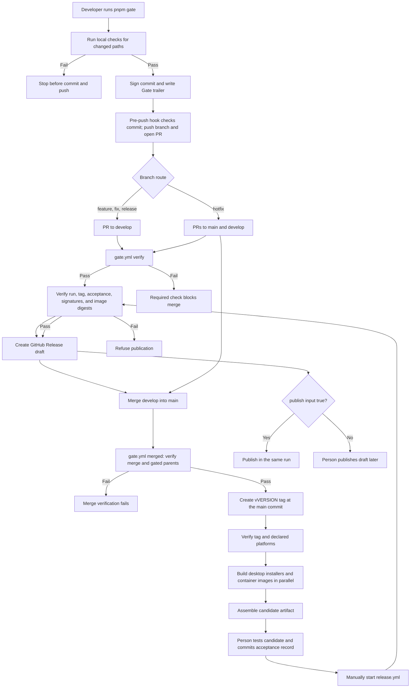

# CI/CD pipeline

The pipeline runs in two places. The local workspace checks a change and pushes it. GitHub verifies the work, builds the products, and publishes an accepted release.

The pipeline has three gates.

1. The local gate runs in the workspace. One command checks the change, commits it, and pushes the branch. A local hook refuses a push that skipped the command.
2. The GitHub gate reads the trailer of that commit. It runs no check again. It accepts the commit or rejects it.
3. The build gates make the products on a clean runner and publish an accepted release.

The manual has two parts. The section "Push gate" describes the local entry and the verifier. The sections from "The stages after the merge" describe the build and the release.

## Pipeline overview



A manual start of `gate.yml` with `release=true` repeats a publishable candidate build. A direct start of `release-candidate.yml` can diagnose selected platforms, but `release.yml` accepts only a Gate run ID. The publication workflow always starts manually.

## Push gate

The pipeline starts in the local workspace. A person runs `pnpm gate` and answers the prompts. Automation supplies the last stage and the commit subject directly.

```bash
pnpm gate
pnpm gate --until=pr -m "feat(graph): add a density slider"
```

Both forms use one straight path: `plan → check → commit → push → pr → merge`. `--until` stops after the named stage. The branch selects the route. Normal branches target `develop`; `hotfix/*` opens PRs to both `main` and `develop`; running on clean `develop` opens its promotion PR to `main`. The promotion path uses the existing merge history, so its commit and push stages report that no new commit or direct push is needed.

Prepare a release on a `release/*` branch. The gate accepts `--version`, `--desktop-targets`, and `--container-platforms`, synchronizes the version files, and writes the platform declaration before checks. Merge that branch into `develop`, then run the gate on `develop` with the same platform lists to open the promotion PR. Every `main` merge needs a new version. The `main` CI creates its tag and immediately builds the candidate.

Before writing a release or hotfix version, gate checks that it is newer than the target branch version and that `vVERSION` is free on `origin`. Promotion repeats this check against `main`. Do not create a version tag in advance; the main CI creates it at the tested main commit.

The first rollout is a one-time bootstrap. While the trusted `main` commit lacks `scripts/gate/branches.mjs`, pass `--base=main` on the gate change branch to land the new verifier on `main`. Then bring the gate into `develop` through a PR. Until `develop` holds its own verifier, its CI reads the trusted verifier on `main`. It never reads the PR head copy. After both branches hold the new verifier, ordinary development branches route only to `develop`.

`plan` changes no files. On a working branch, `check` stages the workspace and writes `.gate/last-run.json`; stopping there leaves the files staged. On `develop`, promotion requires a clean workspace and stages nothing. Stages from `commit` onward require a subject. Every stage prints a short result before the next one starts.

The workflow `gate.yml` is the second gate. It answers one question. Did the author use the local entry on the tree that the change merges? It does not run a check again.

### The gate command

| Option | Effect |
| --- | --- |
| `--until STAGE` | Stop after `plan`, `check`, `commit`, `push`, `pr`, or `merge`. |
| `-m "text"` | Commit subject. Required from `commit` onward. Repeat for a body paragraph. |
| `--base BRANCH` | Assert a target selected by the branch route. |
| `--version VERSION` | Synchronize the version on a `release/*` or `hotfix/*` branch. |
| `--desktop-targets LIST` | Select declared desktop targets on a `release/*` branch; confirm them on `develop`. |
| `--container-platforms LIST` | Select declared container platforms on a `release/*` branch; confirm them on `develop`. |
| `--full` | Run every local check, not only the checks in scope. |
| `--no-sign` | Do not sign the commit. The verifier rejects an unsigned commit. |
| `--allow-protected` | Allow a local run on `main` or `develop`. |
| `--no-hooks` | Do not install the local pre-push hook. |

The `--until` option is the only way to select the stopping stage. `--full` controls check scope.

The command stops before the commit when a check fails. It never forces a push.

The command commits every change in the workspace. Commit or stash unrelated work first.

The command signs the commit with an SSH key. Set the key once. Add the same key to GitHub as a signing key.

The command asks GitHub for the merge only when GitHub can hold the merge back.
GitHub holds an auto-merge request until every required check passes.
A repository without the required `verify` check merges the request at once, a red check included.
The command then prints why it skipped the auto-merge and leaves the merge to you.
A change under the protected paths never asks for an auto-merge, because the verifier asks for the label `gate-change` and a review first.

```bash
git config --global gpg.format ssh
git config --global user.signingkey ~/.ssh/id_ed25519.pub
git config --global commit.gpgsign true
```

### The local brake

The entry needs a hook in the local clone. The hook refuses a push that the gate did not produce. It is a machine brake. The job `verify` stays the authority.

```bash
pnpm gate:hooks
```

The command writes a small file into `.git/hooks/pre-push`. That file calls `scripts/gate/hooks/pre-push` in the checkout that runs the push. The file stays in `.git/hooks`, so a checkout cannot remove the brake without a message. A missing script is a refusal, not a silent skip.

The command `pnpm gate` installs the file again when it is missing. The gate stops before the checks when it cannot install the file. The option `--no-hooks` skips the installation.

The hook makes these decisions.

| Push            | Decision                                                            |
| --------------- | ------------------------------------------------------------------- |
| `main` or `develop` | Refused. Protected branches move through pull requests.         |
| A branch        | The tip commit must pass the same verifier as the job `verify`.      |
| A tag           | The tag must point at a gated commit, or at a merge commit.          |
| A deletion      | Accepted.                                                            |

The hook reads the signature of the tip commit with the local Git. A commit without a signature is refused. When this clone holds no signer list, the hook reports the signature and the job `verify` decides.

Two emergency paths exist.

| Path                                 | Effect                                              |
| ------------------------------------ | --------------------------------------------------- |
| `git push --no-verify`               | Git skips every hook.                               |
| `DBRAIN_GATE_BYPASS=1 git push ...`  | The hook accepts every ref and prints a warning.     |

The job `verify` stays red after either path. The brake stops an accident early. It does not replace the GitHub check.

### The trailer

The gate writes one trailer block into the commit message.

```text
Gate-Version: 1
Gate-Tree: 9a1c4f2e...b7
Gate-Checks: release-check,typecheck,lint-gate,unit,build
Gate-Env: node=24.15.0 pnpm=9.0.0 os=linux arch=x64
Gate-Report: sha256:3f9d...21
Gate-Run: 2026-05-05T09:12:44Z
```

`Gate-Tree` is the Git tree hash of the checked content. The trailer names a tree, not a commit. A rebase and an earlier commit by an editor therefore keep the binding. A change to the content after the gate breaks the binding.

`Gate-Env` records the toolchain of the run. The verifier copies it into the report.

The gate writes the complete report to `.gate/last-run.json`. The file stays out of Git.

### The check list

The file `scripts/gate/checks.mjs` holds every check. It is the single source of truth.

| Check           | Content                                              |
| --------------- | ---------------------------------------------------- |
| `release-check` | The version and the lock files agree.                |
| `syntax`        | Every automation script parses.                      |
| `workflow-lint` | actionlint accepts every workflow file.              |
| `repository-yaml` | The Dependabot and issue-template YAML files parse. |
| `typecheck`     | The TypeScript type checker accepts the workspace.   |
| `lint-gate`     | No new lint diagnostic appears.                      |
| `unit`          | The release and library tests pass.                  |
| `build`         | The server and the web app build.                    |
| `smoke-server`  | The server answers against an isolated database.     |

Each check has a path scope. The gate runs a check only when the change touches its scope. The option `--full` runs every check.

The check `workflow-lint` caches the actionlint binary under `.gate/tools`. It verifies two pinned SHA256 values, so a changed cache is refused. A cold cache downloads the release one time. The variable `DBRAIN_GATE_TOOLS` moves the cache.

Every check runs in the local gate, and every check id enters the trailer. The list holds no check for a clean runner. The release candidate builds and verifies the products instead.

### The verifier

The jobs `verify` and `merged` copy the gate verifier and its sibling modules from a trusted commit and run that copy. They fail if no trusted verifier exists. A change cannot weaken the judge that reads it.

- The job `verify` reads the base commit of the pull request.
- The job `merged` reads the previous tip of `main` or `develop`. Before develop receives its first verifier, both jobs may read the protected main tip.

The verifier takes about 30 seconds. It installs no dependency. It makes these decisions.

1. The head commit holds a trailer, and the protocol version is known.
2. The tree of the head commit equals `Gate-Tree`.
3. The trailer lists every check that the changed paths require.
4. No tracked file is on the deny list. The deny list holds a local `.env` file, a dependency, a local database, a build output, and a key file.
5. A change to `scripts/gate/**`, `scripts/gate.mjs`, or `.github/workflows/gate.yml` needs the label `gate-change` and a review. `pnpm gate:policy --apply` creates the label. Adding or removing the label runs the job again, so the verdict follows the label.
6. The commit signature is valid. The verifier reads the result from the GitHub API.

A rejected commit fails the job. The ruleset makes the job `verify` a required status check, so the merge is blocked.

On a repository without a ruleset the check cannot be required. The merge is then never blocked automatically. Add the label, let the job pass, and merge by hand.

Rule 6 keeps the identity of the author. A signature proves a claim. It does not prove that a command ran. An author can write a false trailer. The branch ruleset and the review of the gate files are the defence against that.

### The merge gate

Every change reaches `main` or `develop` as a merge commit. The job `merged` reads that commit. A promotion PR verifies each merge on the first-parent history of `develop` since the `main` tip.

The commit must have two parents. The first parent is the previous tip of `main`, which an earlier run accepted. The second parent is the head of the pull request. The job makes these decisions about every parent after the first.

1. The parent holds a trailer, and the protocol version is known.
2. The tree of the parent equals `Gate-Tree`.
3. The commit signature is valid.

A push that is not a merge commit fails. A direct push to either protected branch cannot pass the ruleset.

## The stages after the merge

| Stage      | Workflow and job                                | Trigger                    | Product                                                |
| ---------- | ----------------------------------------------- | -------------------------- | ------------------------------------------------------ |
| Verify     | `gate.yml`, job `verify`                        | A PR to `main` or `develop` | The gate verdict on the branch route and commits      |
| Merge      | `gate.yml`, job `merged`                        | A push to `main` or `develop` | The gate verdict on the merge                       |
| Tag        | `gate.yml`, job `tag`                           | A push to `main`           | The version tag at this main commit                     |
| Candidate  | `gate.yml`, job `release` → `release-candidate.yml` | Every main push        | The declared products and one candidate                |
| Publication| `release.yml`                                   | A manual start             | A draft release, or a published release                 |

A pull request builds no product. Every successful merge to `main` starts a clean-machine candidate build.

The product build reads the declaration in `scripts/release/release.json`. The next section describes the declaration.

### The tag

The job `tag` reads the version from `scripts/release/release.json` on every main push.

- The tag exists at another commit: the job fails. Increase the version before the merge.
- The tag exists at this commit: the job uses it for a repeated candidate run.
- The tag is missing: the job creates `vVERSION` at the pushed commit and pushes the tag.

The job `release` then calls `release-candidate.yml` on every main push. A manual start of `gate.yml` with `release=true` repeats the candidate for an existing tag, for example after a failed platform build.

## Release candidate

`release-candidate.yml` starts from the job `release` of `gate.yml`. It also starts from a manual start.

| Input                 | Meaning                                              | Default |
| --------------------- | ---------------------------------------------------- | ------- |
| `tag`                 | The version tag, for example `v0.1.1`                | None    |
| `signed`              | Verify Windows and macOS signatures and notarization | `true`  |
| `desktop_targets`     | A part of the declared desktop targets               | Empty   |
| `container_platforms` | A part of the declared container platforms           | Empty   |

An empty input builds the whole declaration. The job `verify-tag` accepts the tag or rejects it. It checks these items.

1. The version in the release files equals the tag. The script `scripts/release/check.mjs` makes this decision.
2. The commit of the tag is on the default branch.

### The declared platforms

One file declares the release. `scripts/release/release.json` holds the version and the two platform lists.

```json
{
  "version": "0.1.1",
  "desktopTargets": ["linux-x64"],
  "containerPlatforms": ["linux/amd64"]
}
```

The gate writes that file from the platform options on a `release/*` branch. The local checks verify it, the merge into `develop` carries it, and the main tag pins it. The candidate builds exactly the platforms in the file at the tag. This example releases Linux only.

The script `scripts/release/platforms.mjs` holds the runner of each platform. That table is the universe. A declared name outside it stops the local gate and the job `verify-tag`, before a runner starts.

The inputs `desktop_targets` and `container_platforms` only narrow the declaration, for a repeat after a failed platform build. A name outside the declaration is refused. A name that the runner table does not hold is refused as well.

The candidate then holds the declared platforms only. The acceptance record covers those platforms only. The publication gate accepts such a candidate, so a release publishes the platforms that the record covers.

The job `desktop` then builds the declared targets. Each matrix job has a limit of 90 minutes.

| Runner             | Target        |
| ------------------ | ------------- |
| `ubuntu-22.04`     | `linux-x64`   |
| `windows-2022`     | `win32-x64`   |
| `macos-15-intel`   | `darwin-x64`  |
| `macos-15`         | `darwin-arm64`|

Each desktop job runs these steps.

1. Install FFmpeg for the platform.
2. Restore the Rust dependency cache.
3. Download the pinned PocketBase binary.
4. Prepare the desktop runtime.
5. Run the desktop backend smoke test.
6. Run the Rust library tests with `cargo test --locked --release --lib`.
7. Build the installer with `pnpm --filter desktop tauri build --ci`.
8. Verify the Linux package.
9. Verify the macOS signature with `codesign` and `spctl`.
10. Verify the Windows signature with `Get-AuthenticodeSignature`.
11. Collect the installers, the runtime manifest, and the hashes.
12. Upload the artifact `desktop-TARGET-RUN_ID-ATTEMPT`.

Steps 9 and 10 run only when the input `signed` is `true`.

A signed build uses the environment `release`. An unsigned build uses the environment `candidate`. A signed job removes the temporary signing key at the end.

### Desktop signing setup

Create the GitHub Actions environment `release` in repository Settings → Environments. Add these environment secrets. The workflow reads them only for signed Windows and macOS jobs. Keep the original certificate and private key outside this repository.

| Secret | Value |
| --- | --- |
| `APPLE_CERTIFICATE` | Base64 text of an exported Developer ID Application `.p12` file, including its private key |
| `APPLE_CERTIFICATE_PASSWORD` | Password used when exporting that `.p12` file |
| `APPLE_SIGNING_IDENTITY` | Exact Developer ID Application identity shown by `security find-identity -v -p codesigning` |
| `APPLE_API_PRIVATE_KEY` | Complete text of the App Store Connect API `.p8` private key |
| `APPLE_API_KEY` | Key ID of that API key |
| `APPLE_API_ISSUER` | Issuer ID of that API key |
| `WINDOWS_CERTIFICATE` | Base64 text of a code-signing `.pfx` file, including its private key |
| `WINDOWS_CERTIFICATE_PASSWORD` | Password of that `.pfx` file |

For macOS, create a [Developer ID Application certificate](https://developer.apple.com/help/account/certificates/create-developer-id-certificates/) in the Apple Developer account. Export the certificate and private key together as `.p12` from Keychain Access. Create an [App Store Connect API key](https://developer.apple.com/documentation/AppStoreConnectAPI/creating-api-keys-for-app-store-connect-api) for notarization. The CI imports the certificate into a temporary keychain and writes the `.p8` key to a temporary file. Do not use a Mac App Store distribution certificate for this workflow.

For Windows, obtain a trusted Authenticode code-signing certificate and export it with its private key as `.pfx`. The CI imports it into the runner certificate store. The Tauri build signs with its thumbprint and an RFC 3161 time stamp. See [Microsoft's SignTool guidance](https://learn.microsoft.com/en-us/windows/win32/seccrypto/time-stamping-authenticode-signatures).

Encode each certificate file as one-line Base64 before adding it as a secret. On macOS or Linux, use `base64 < certificate.p12 | tr -d '\n'` or the same command with `certificate.pfx`. Put the resulting text into the matching secret. Put the `.p8` file contents directly into `APPLE_API_PRIVATE_KEY`. Do not print these values in CI logs or commit them.

After the secrets are set, start a signed candidate for an existing tag from `main` with `gh workflow run gate.yml --ref main -f release=true`. Check that the macOS and Windows jobs pass signing verification and that `assemble` uploads `candidate-RUN_ID-ATTEMPT`. An unsigned diagnostic run cannot pass the publication gate. [GitHub's environment secret guide](https://docs.github.com/en/actions/how-tos/write-workflows/choose-what-workflows-do/use-secrets) shows where to add the secrets.

The desktop updater uses a separate Tauri signing key. Generate it with `pnpm --filter desktop tauri signer generate -w PATH/TO/updater.key`. Put only the `.pub` file contents in `apps/desktop/src-tauri/tauri.conf.json` under `plugins.updater.pubkey`. Store the private key as `TAURI_SIGNING_PRIVATE_KEY` in the `release` environment; set `TAURI_SIGNING_PRIVATE_KEY_PASSWORD` there if the key has a password. Never commit the private key. Signed desktop candidates include the updater bundle and `.sig` file. After acceptance, `release.yml` generates `latest.json` and publishes it with the signed bundles. Installed apps check the latest published release at startup. [Tauri's updater guide](https://v2.tauri.app/plugin/updater/) defines the signature and metadata formats. The updater downloads a complete bundle; it does not implement byte-level delta patches.

The container build pushes `candidate-RUN_ID-ATTEMPT` images after smoke tests. If `DBRAIN_DEPLOY_TARGETS` is set, the candidate workflow sends `deploy/update.sh` to each registered SSH server and selects that exact candidate. See [Operations](operations.md) for target registration and the self-hosted command. The desktop build can fail independently without blocking container deployment. Publishing an accepted release also gives the verified container digests a `vVERSION` tag, so the same update script can select a release.

The job `containers` builds the declared architectures.

| Runner             | Architecture |
| ------------------ | ------------ |
| `ubuntu-22.04`     | amd64        |
| `ubuntu-24.04-arm` | arm64        |

Each matrix job has a limit of 60 minutes. It builds the three images, starts the test stack, and runs the smoke client. The job pushes the images to GHCR only after the smoke test passes.

Each job uploads an artifact with the name `container-ARCH-RUN_ID-ATTEMPT`. The artifact holds the digest report of one architecture.

The job `merge` downloads the report of every declared architecture. It then creates one multi-architecture digest for each service. The final artifact `containers-RUN_ID-ATTEMPT` holds `container-report.json`.

The environment of the jobs is `candidate`.

## Candidate assembly

The job `assemble` waits for the jobs `desktop` and `containers`. It downloads the artifacts of one run ID and one attempt. The script `scripts/release/candidate.mjs` then assembles the candidate. The script verifies these items.

- The version, the commit, the run ID, and the attempt are equal in every report.
- Each desktop target holds the expected installer formats.
- Each `SHA256SUMS` file matches the files in its directory.
- Each container image reference holds a digest.
- The smoke test passed for every image.

The candidate artifact has the name `candidate-RUN_ID-ATTEMPT`. The retention period is 30 days. The candidate holds these files.

| Path                                                       | Content                                                  |
| ---------------------------------------------------------- | -------------------------------------------------------- |
| `linux-x64/`, `win32-x64/`, `darwin-x64/`, `darwin-arm64/` | Installers, build report, runtime manifest, hashes       |
| `containers/container-report.json`                         | Image digests for three services and each declared architecture |
| `deployment/`                                              | `docker-compose.yml`, `nginx.conf`, and `.env.example`   |
| `candidate-index.json`                                     | The identity of the candidate and a SHA256 for each file |
| `acceptance-template.json`                                 | The empty acceptance record                              |

Do not mix artifacts from different attempts. After a failure, use "Re-run all jobs". A re-run of one job only creates a new attempt, and the assembler then rejects the mix.

## Acceptance gate

A person downloads the candidate and tests it. The person then copies `acceptance-template.json` to `docs/release-acceptance/vVERSION.json`. Create the directory on the first record.

The record must contain these values.

- `reviewer`: a non-empty name.
- `reviewedAt`: a date that the parser accepts.
- `checks`: every item has the status `passed` and at least 10 characters of evidence.
- `thirdPartyMaterials`: a public HTTPS address and a SHA256 value.
- `candidateIndexSha256`: the hash of the candidate index.

The acceptance items are these.

| Group               | Items                                                                                     |
| ------------------- | ----------------------------------------------------------------------------------------- |
| Each desktop target | `installation`, `uninstall`, `csp`, `media`, `upgrade`, `process-exit`                    |
| The product         | `third-party-materials`, `historical-data-migration`, `backup-restore`, `known-lint-debt` |

The gate rejects a pending item, an empty evidence field, and a changed candidate. The value `candidateIndexSha256` binds the record to one candidate.

## Publication gate

`release.yml` runs only from the default branch. The job uses the environment `release`.

The job verifies the run and the tag in this order.

1. The run ID is a number.
2. The tag matches the pattern `vMAJOR.MINOR.PATCH`.
3. The current ref is the default branch.
4. The candidate run is a successful run of `gate.yml` in this repository, on the default branch. The script `scripts/release/validate-run.mjs` makes this decision.
5. The commit of the tag equals the head SHA of the candidate run.
6. The head SHA is an ancestor of the current commit.
7. The version is equal in the release files and the tag. The script `scripts/release/check.mjs` makes this decision. The version at the source commit is also equal to the tag.
8. Every acceptance item passed. The script `scripts/release/candidate.mjs approve` makes this decision.
9. A signed build with a verified signature exists for `win32-x64`, `darwin-x64`, and `darwin-arm64`.
10. Every image digest in the report is valid. The script `scripts/release/verify-images.mjs` makes this decision.

The job refuses to replace an existing release. It creates a draft, and a person publishes the draft. The input `publish` can publish the release in the same run.

A tag with a suffix, for example `v0.1.0-rc.1`, creates a prerelease.

## Repository policy

The gate needs five repository settings. The script `scripts/gate/apply-ruleset.mjs` prints the plan. With `--apply`, it writes the settings.

```bash
pnpm gate:policy
pnpm gate:policy --apply
```

| Setting                        | Value                                                    | Reason                                                       |
| ------------------------------ | -------------------------------------------------------- | ------------------------------------------------------------ |
| Auto-merge                     | On                                                       | The local gate asks GitHub to merge the pull request.        |
| Auto-merge, effective          | Only when `verify` is a required check                    | Without the required check, GitHub merges the request at once. The gate then leaves the merge to you. |
| Merge methods                  | Merge commit only                                        | The job `merged` reads the second parent of the merge commit.|
| Delete merged source branch    | Off                                                      | A hotfix branch must remain for its second PR.                |
| Pull request                   | Required for `main` and `develop`                        | A direct push cannot bypass the gate.                        |
| Status checks                  | `verify`, from GitHub Actions, and the branch must be current | The gate must pass before the merge.                    |
| Force push and branch deletion | Blocked                                                  | A gated commit cannot leave the history.                     |
| Label                          | `gate-change` exists                                     | A person attaches it to approve a change to the gate itself. A label must exist before a pull request can carry it. |

`pnpm gate:policy --apply` writes the settings, the ruleset, and the label.

The owner needs a `gh` login with admin access. The token of a workflow cannot change a ruleset.

A private repository on a free plan has no rulesets and no branch protection.
The GitHub API then answers `403`.
The gate prints the plan and reports the refusal.
Apply the policy again after an upgrade to GitHub Pro, or make the repository public.
Until then the required check cannot exist, and the gate never asks for a merge.

The local brake then carries the entry. It refuses a direct push to `main` or `develop`, a commit without a trailer, and a commit without a signature. GitHub reports the verdict. The local machine refuses the push.

Two items are manual.

1. Register an SSH signing key on each author account. The verifier rejects an unsigned commit.
2. Keep `open-pull-requests-limit` at `0` in `.github/dependabot.yml`. A bot pull request carries no local trailer, and the verifier rejects it. A dependency update arrives through the local gate.

## Security controls

Every workflow limits its permissions. The jobs `verify` and `merged` request read access only. The job `tag` adds `contents: write` to push the tag. The release candidate adds `packages: write`. The publish job adds `contents: write` to create the release.

The checkout step of a read-only job does not keep the credentials. Each action step uses a full commit SHA, not a version tag.

A job logs in to GHCR only to push an image or to read a digest. The job logs out at the end.

The release job uses the environment `release`. The container candidate jobs and the unsigned desktop jobs use the environment `candidate`. A protected environment can hold secrets and require an approval.

## Caches

| Cache           | Key parts                                            | Writer                       |
| --------------- | ---------------------------------------------------- | ---------------------------- |
| pnpm store      | Operating system, architecture, lock file            | Every job with `setup-node`  |
| Desktop Next.js | Operating system, target, Node version, lock file    | Default branch only          |
| Rust            | Target, signing mode, compiler, lock file, environment | Default branch only        |
| Docker          | Service and architecture                             | Default branch only          |

The release candidate writes the Docker cache of every architecture that it builds. A pull request writes no cache.

A cold build runs every step. A failed Docker cache export does not fail the build.

## Reproduce the pipeline locally

The push gate runs stages in order. `--until=plan` prints the check plan without staging files or running checks.

```bash
pnpm gate --until=plan
```

Run these commands from the repository root. Use them for a diagnosis of one check.

```bash
pnpm install --frozen-lockfile
pnpm release:check
pnpm check-types
pnpm lint:gate
pnpm test:release
pnpm build
```

The container test needs an isolated project. Do not use real data.

```bash
export DBRAIN_ADMIN_EMAIL=ci@dbrain.invalid
export DBRAIN_ADMIN_PASSWORD=ci-operator-password
export DBRAIN_IMAGE_PREFIX=dbrain-ci
export DBRAIN_VERSION=test
export DBRAIN_PORT=13080
docker compose -p dbrain-ci -f docker-compose.yml -f deploy/compose.test.yml up --build --wait
export DBRAIN_SMOKE_SERVER_URL=http://127.0.0.1:13081
export DBRAIN_SMOKE_PB_URL=http://127.0.0.1:13090
export DBRAIN_SMOKE_WEB_URL=http://127.0.0.1:13080
export DBRAIN_SMOKE_ADMIN_EMAIL=ci@dbrain.invalid
export DBRAIN_SMOKE_ADMIN_PASSWORD=ci-operator-password
node scripts/release/server-smoke.mjs
docker compose -p dbrain-ci -f docker-compose.yml -f deploy/compose.test.yml down -v
```

The smoke client needs FFmpeg on the host. The client creates the media fixtures.

The file `deploy/compose.test.yml` is a CI artifact. Do not use it on a host with important data.

## Start a workflow by hand

```bash
gh workflow run gate.yml --ref main -f release=true
gh run list --workflow gate.yml
gh run watch RUN_ID
gh run download RUN_ID --name candidate-RUN_ID-ATTEMPT --dir candidate
gh workflow run release.yml --ref main -f candidate_run_id=RUN_ID -f tag=v0.1.1 -f publish=false
```

A manual start of `gate.yml` repeats a publishable candidate for an existing tag. A direct start of `release-candidate.yml` can diagnose a subset of declared platforms, for example after a failed platform build. That standalone run cannot be passed to `release.yml`.

```bash
gh workflow run gate.yml --ref main -f release=true
gh workflow run release-candidate.yml --ref main -f tag=v0.1.1 -f signed=true -f desktop_targets=linux-x64 -f container_platforms=linux/amd64
```

## Rules for the pipeline

1. Put reusable logic in `scripts/release/` or `scripts/gate/` and call it from a workflow. Keep a workflow step short.
2. Keep `scripts/release/check-workflows.sh` green. It runs actionlint over every workflow file.
3. Do not change a trigger path without a review. A new path filter changes the jobs of other people.
4. Do not start a publish or a signed build unless the task asks for a release.
5. Update `.github/pull_request_template.md` when a new release gate appears.
6. Keep the check list in `scripts/gate/checks.mjs`. Never add a check to a workflow only. The verifier reads the list at the base commit.
7. Change `scripts/gate/**` with the label `gate-change` and a review. The verifier rejects a change to the judge without one.
8. Keep `scripts/gate/hooks/pre-push`. It is the brake of a repository without a ruleset.
9. Declare the platforms of a release in `scripts/release/release.json`. The runner table in `scripts/release/platforms.mjs` holds the names that exist. The test `platforms.test.mjs` makes this decision.

## Related manuals

- `docs/development.md` describes the environment, the quality gates, and the maintenance.
- `docs/operations.md` describes the deployment of the images, the backup, and the restore.
- `docs/usage.md` describes the installation, the upgrade, and the desktop data.
- `.github/AGENTS.md` holds the rules for the workflow directory.
