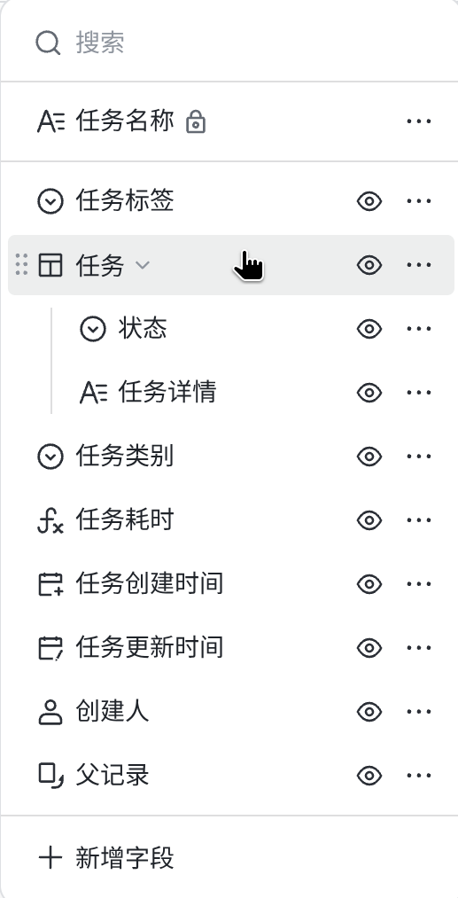
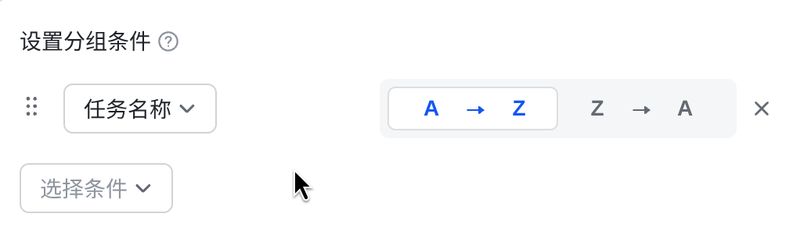
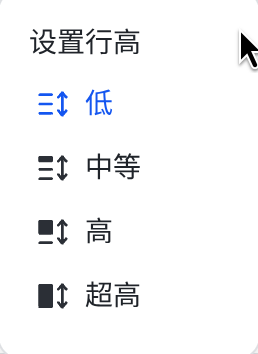

# 设计改进

以下是dataview基础框架的改进和table视图的设计改进

## dataview的基础框架

视图配置不再使用侧边栏展示和配置
统一集成在视图的toolbar，按钮+下拉菜单的形式 : 视图配置靠左对齐，视图功能靠右对齐

## table

### 字段

缺少字段的增删改
表格中应该在列末添加“+”按钮表示增加字段
添加字段编辑的下拉菜单:包括标题、字段类型、可选值或默认值

例如：

### toolbar

视图配置依次是：添加记录、字段配置、筛选、分组、排序、行高、填色
视图功能依次是：搜索

#### 字段配置

下拉菜单中包括：搜索、字段项、添加字段
字段可以编组、拖动改变次序、隐藏

点击字段项的更多按钮：出现包括编辑、创建编组、加入编组（若已有编组）、删除的子菜单

点击编辑出现字段编辑下拉菜单

#### 筛选

下拉菜单内复用filter组件

#### 分组

根据字段分组，下拉菜单中需要设置分组条件，点击选择字段则出现带搜索的字段列表下拉菜单

#### 排序

根据字段排序，下拉菜单中需要设置排序条件，点击选择字段则出现带搜索的字段列表下拉菜单
之后选择排序顺序

#### 行高

分低、中、高、超高

#### 填色

需要设置填色条件,可对满足条件的单元格、行、列填指定颜色

