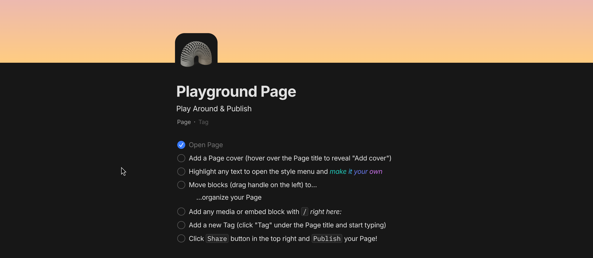

# 完善node-content组件

> 设计文档：[../node-content/README.md](../node-content/README.md)
> 两条支线：选择器 [../node-content/selectors.md](../node-content/selectors.md)、批注 [../node-content/annotation.md](../node-content/annotation.md)

位置：packages/ui/src/components/dialog/editor/content
以下的更新设计涉及：组件改造，数据模型更新及其全链路改造

## text

核心修改：将内容由一行字符串改为rich-text的一行block，由editor渲染
样式：居中，字号较大，四周留白，禅意
适用场景：名言、定理、公式等

## image

照片编辑
批注:覆盖一层批注组件

## audio

自定义音频组件
时间戳笔记

## video

自定义视频组件
时间戳笔记

## pdf

自定义pdf组件
批注:覆盖一层批注组件

## rich-text

cover:点击出现cover-selector
icon:点击出现icon-selector
title
summary
semantic pill
rich-text-content

示例如下

