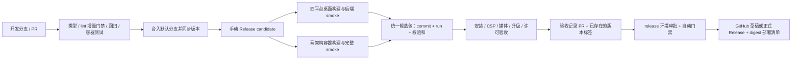

# dBrain 开发、维护与发布流程

本流程适用于 Linux amd64/arm64 容器，以及 Linux x64、Windows x64、macOS Intel/Apple Silicon 桌面端。应用内自动更新尚未接入；首版通过安装包升级。实际验收状态见 [发布验收报告](release-readiness.md)。



## 日常开发与维护

使用 `.node-version` 的 Node、`packageManager` 的 pnpm 和 `rust-toolchain.toml` 的 Rust；运行 `pnpm install --frozen-lockfile`。新增依赖时显式修改对应 workspace，提交 pnpm-lock.yaml；Rust 依赖同步 Cargo.lock。`pnpm dev:full` 启动服务开发环境，`pnpm dev:desktop` 启动桌面环境。PocketBase、FFmpeg 和系统 GTK/WebKit 依赖按 desktop README 安装。

首次在一台机器上开发前，先创建 `.env`：

```sh
cp .env.example .env
# 填 DBRAIN_ADMIN_EMAIL 与 DBRAIN_ADMIN_PASSWORD（密码可用 openssl rand -base64 24 生成）
```

`.env` 是 PocketBase 运维账号的唯一来源，被 `pnpm dev:full` 与仓库内 `docker compose` 共用；**缺失或字段不全时两者都会直接失败**（Compose 在渲染阶段就拒绝，dev 栈在启动 PocketBase 前退出）。原因与账号用途见下文"运维账号"。`.env` 已被 gitignore，不要提交真实值；shell 里已有的同名变量优先于文件内容。

提交前运行：

```sh
pnpm release:check
pnpm check-types
pnpm lint:gate
pnpm test:release
```

`pnpm lint` 仍是原始报告入口。共享 ESLint 配置中的 only-warn 会降级错误，因此 CI 使用 `lint:gate`：扫描全部 19 个包，与 `scripts/release/lint-baseline.json` 的文件、规则、消息和次数比较；新增诊断、次数增长、配置/解析失败均会失败。当前保留 89 条诊断，不意味着严格 ESLint 零错误。修复存量问题后可运行 `node scripts/release/lint-gate.mjs --update-baseline` **缩减**基线；任何基线扩张需在 PR 解释。CI 不更新基线。新增 workspace 或自定义 lint 命令需同步门禁覆盖范围。

从短期开发分支发起 PR，默认分支保留可构建状态。配置分支保护时要求 CI 的 `changes`、`check`、`containers` 完成，并要求代码审查；不适用的检查会由 job 条件跳过。依赖更新由 Dependabot 发 PR，仍执行质量与后端检查；首版期间常规升级上限为 0，三种生态的计划扫描均为 monthly，安全更新不受常规版本上限限制。PR 模板记录实际验证及发行影响；Bug 模板要求产品版本、OS/架构、安装格式与复现步骤。每周处理构建/依赖问题，每个版本处理发布验收记录中的已知问题；Node/PocketBase/FFmpeg/Tauri 升级必须重新验收四平台及数据库备份恢复。不要在主线已验收版本上直接改 migration，使用新增 migration。

工作流修改也由 CI 使用固定版本、官方 SHA256 校验过的 actionlint 检查。脚本下载限 Linux amd64 检查 job；关闭 actionlint 的可选 shellcheck 子工具，工作流结构/表达式/复用关系仍检查。

## Runner 使用范围

| 场景 | 自动使用的 runner |
| --- | --- |
| 发往 main/develop 的草稿 PR | 不分配；转为 ready for review 后验证 |
| 仅文档、许可证、Issue 模板、技能或 Dependabot 配置改动 | 一个轻量 Linux 分类 job，不安装依赖、不构建 |
| 仅 apps/desktop/ 或 rust-toolchain.toml 改动 | 分类 + quality/backend 检查，跳过容器 job |
| 共享源码、锁文件、部署、工作流或其他未分类路径 | 分类 + 完整质量/后端检查 + 容器验收 |
| Dependabot PR | 分类 + 质量/后端检查，跳过额外容器栈；合入 main 后再验收容器 |
| main 代码推送 | 按路径检查；develop 推送和普通开发分支推送不另跑一轮 |
| 手动 CI / Release candidate | 始终完整检查，候选四桌面目标和双架构容器不按路径删减 |
| 手动桌面诊断 | 默认 linux-x64，可显式选择其他单目标或 all |

路径分类使用完整 Git diff，包含删除与重命名两侧的路径，不受 API 前 300 个文件限制；新增分支、历史不可用或未知事件退回完整检查。未知路径默认视为代码，只有明确的文档范围被排除。正常 PR 使用三点 diff，push 使用 before..after。容器 job 等待质量检查成功后才分配 runner，避免质量失败时继续消耗容器构建时间。验收记录在 docs/ 下也不会触发二进制重建，正式发行仍单独验证它们。

采用 job 条件而非工作流 paths-ignore，保留检查状态，避免以后启用 required checks 时让文档 PR 卡在 Pending；见 [GitHub 对跳过检查的说明](https://docs.github.com/en/pull-requests/how-tos/merge-and-close-pull-requests/troubleshooting-required-status-checks)。同一 PR/main 的更新取消旧 CI；同一分支和目标的新桌面诊断取消旧诊断。手动统一候选和发行维持串行、不自动取消；候选内部 CI 与单目标诊断分开并发组。发行从非默认分支启动时，不分配发布 runner。

## 首次启用 GitHub

将工作流提交并推送到仓库默认分支后，在 Settings 开启 Actions；配置：

| 配置 | 要求 |
| --- | --- |
| `candidate` environment | 只允许受信开发/发布分支；容器任务需要 packages:write，以上传已测试候选镜像。确认 GHCR 包的访问范围与闭源发行策略一致。 |
| `release` environment | 限默认分支/正式构建分支，配置 required reviewers，并禁止自行批准。签名构建和正式发布均使用此环境。环境审批能力取决于 GitHub 账户套餐及仓库类型，应在 Settings 实际核对。 |
| Windows Secrets | `WINDOWS_CERTIFICATE`（PFX 的 base64）、`WINDOWS_CERTIFICATE_PASSWORD`。证书必须可用于代码签名；工作流验证安装器 Authenticode 状态和证书指纹。 |
| macOS Secrets | `APPLE_CERTIFICATE`（P12 base64）、`APPLE_CERTIFICATE_PASSWORD`、`APPLE_SIGNING_IDENTITY`、`APPLE_API_PRIVATE_KEY`、`APPLE_API_KEY`、`APPLE_API_ISSUER`。使用 Developer ID 和公证凭据。 |
| Packages | 给仓库的 GITHUB_TOKEN 授权候选包上传/读取；消费者能访问发行清单指定的 GHCR digest。 |
| 标签 | 保护 `v*` 标签，禁止移动已发布标签。正式发布只接受已存在且指向候选 commit 的标签。 |

这些是仓库管理配置，本轮仅编写工作流，未替你设置远端权限、Secrets 或审批。未签名候选可构建和检查，但正式发布门禁拒绝未签名的 Windows/macOS 候选。

## 构建统一候选

1. 在版本 PR 中运行 `pnpm release:version 0.1.0`（后续替换实际版本），检查变更并合入默认分支。
2. 在该提交运行 `Release candidate`。首次排查可用 `signed=false`；准备发行时使用 `signed=true`。

```sh
gh workflow run release-candidate.yml --ref main -f signed=true
# main 替换为仓库实际默认分支；记录返回/查询得到的 run ID。
gh run list --workflow release-candidate.yml
gh run watch RUN_ID
```

候选流程先复用完整 CI，再构建四个桌面目标和两个原生 Linux 容器架构。容器每个架构先 `up --no-build` 并运行完整 server-smoke，之后推送同一批本地镜像；合并为 multiarch index，并验证平台列表。标签为 `candidate-RUN_ID-ATTEMPT`，发行依据为不可变 digest，不依赖标签后续指向。桌面 workflow 单独触发时也会构建产物，但不能代替统一候选流程。

统一 artifact 名称为 `candidate-RUN_ID-ATTEMPT`，默认保留 30 天，受仓库 artifact 保留策略限制。**失败后的重跑必须选择 Re-run all jobs**；只重跑失败 job 会混入不同 attempt 的产物，汇总故意拒绝。过期候选需重新构建和验收。

排查桌面平台问题时，可单独运行 `desktop-build.yml`，传入 `target=linux-x64`、`win32-x64`、`darwin-x64` 或 `darwin-arm64`；默认 `linux-x64`，仅显式传 `target=all` 才运行四个平台。不同目标的诊断可并行，同一分支和目标的新诊断会取消旧诊断。统一候选的可复用调用仍始终构建四个平台，单目标诊断产物不能用于正式发布。后端 smoke 步骤有 5 分钟外层超时，媒体样本生成有 30 秒超时，macOS 超时时采集 FFmpeg 栈。

Linux 构建还会提取实际 DEB/AppImage，核对资源完整性并执行完整后端 smoke（DEB 要求全部准备哈希一致；AppImage 允许原生 ELF 路径修补，JS/migrations/静态 PocketBase 保持原字节）；原生 Cargo build/test 使用 `--locked`。

`runtime-manifest.json` 的 hashes 是准备阶段的资源哈希；AppImage ELF 路径修补或平台签名可能再改变原生文件。`build-report.runtimeHashScope` 标明该范围，最终安装包及发布资产用外层 SHA256SUMS 核对，不能把准备阶段哈希直接当作所有安装格式的最终资源哈希。

候选包含每平台安装器、LICENSE、runtime-manifest、build-report、SHA256SUMS，容器报告、源提交的部署配置、candidate-index 及待填写的 acceptance-template。构建 job 只验证后端和打包/签名，不自动认定原生 GUI 安装、CSP、播放和升级通过。

## 私有内部测试（首版安排）

用户决定首版先内部测试，继续使用当前私有仓库。[build 38123782093 的草稿](https://github.com/Yuqi-666/dBrain/releases/tag/untagged-d1ebf75893254e4394bf) 绑定 `c9f4b7646e73a4255e1e85b1724535297ccdf3f7`，完整候选和独立下载校验均通过；修复已由 PR #16 合入 main（902569b）。草稿包含四平台 ZIP、容器部署 ZIP、来源索引、待验收模板、内测说明及外层 SHA256SUMS。按系统选择 ZIP，解压后再核对平台目录内的校验清单；容器配置在 deployment.zip 的 deployment/ 目录，digest 在 containers/container-report.json 中。

这份草稿是未签名内部候选，不能使用正式发行门禁当作已验收版本。验收模板保持 pending，逐项完成原生窗口、安装卸载、媒体与升级测试后记录证据。草稿未发布，供有草稿访问权限的仓库维护者审查；如向更多内部测试者分发，应先安排私有仓库访问权限并审查草稿。正式发行仍按下节完成签名与验收，不使用本次内部构建标记替代 `v0.1.0` 标签。

## 验收与发布

下载统一候选，校验后在对应系统完成安装、卸载、CSP、音视频、升级以及进程退出验收；补齐第三方许可/对应源码材料、历史附件/工作空间迁移方案和备份恢复验证。每一项保留日志/截图/测试记录，关联候选 commit 和安装器 SHA256。

```sh
gh run download RUN_ID --name candidate-RUN_ID-ATTEMPT --dir candidate
```

复制 `candidate/acceptance-template.json` 到 `docs/release-acceptance/v0.1.0.json`，填写 reviewer、UTC review 时间、每个 check 的 `passed` 与 evidence。`thirdPartyMaterials` 必须填实际发行材料的 HTTPS 地址与 SHA256；材料应覆盖候选中实际 npm/Rust/native/Node/PocketBase/FFmpeg 组件的许可和相应源码义务。**URL 与 hash 是审查人声明，门禁不下载材料或代替人工许可审查。** 确保发行受众实际可获取材料，并把第三方审查证据写入对应 check。模板 pending 值、空证据均拒绝。

通过 PR 审查并合入验收记录；它是控制分支上的新增文档提交，候选二进制仍绑定此前 source commit。创建 `v0.1.0` 标签指向已验收 source commit，推送标签。运行 `Publish accepted release` 必须从当前默认分支启动，且候选 source commit 必须是它的祖先；控制分支中的产品版本需仍与该标签一致。发布后再推进下一版本。

```sh
git tag -a v0.1.0 SOURCE_COMMIT -m 'dBrain 0.1.0'
git push origin v0.1.0
gh workflow run release.yml --ref main -f candidate_run_id=RUN_ID -f tag=v0.1.0 -f publish=false
```

`publish=false` 创建草稿。`publish=true` 在同一次运行通过环境审批、验收和 registry digest 核对后创建草稿，再转为正式 Release。带预发布后缀的版本标记为 prerelease。流程只搬运已验收安装包，不重建；不改变候选镜像 digest。现存 Release 会拒绝覆盖。草稿创建后需公开时，在 GitHub UI 审查并发布该草稿；不要用工作流覆盖已有草稿。上传失败可能留下部分草稿资产，应逐项核对 SHA256SUMS 后补齐，或删除未发布草稿并重试。正式发行后不要覆盖资产，应发新版本。

自动检查只能验证来源、一致性与填写完整性；平台测试、证书有效性、第三方材料内容和历史数据归属仍须实际验证。当前没有一份真实完成的验收记录，因此本流程不会把现状认定为可正式发布。

## 容器部署、升级与恢复

下载 Release 的 `docker-compose.yml`、`compose.release.yml`、`nginx.conf`、`.env.example` 到同一目录。发行 Compose 已调整 nginx 配置相对路径；覆盖层通过 digest 指向已验收镜像。先把 `.env.example` 复制为 `.env` 并填好 `DBRAIN_ADMIN_EMAIL` 与密码——没有它 Compose 会拒绝渲染。然后检查配置：

```sh
docker compose -f docker-compose.yml -f compose.release.yml config
docker compose -f docker-compose.yml -f compose.release.yml pull
docker compose -f docker-compose.yml -f compose.release.yml up --no-build --wait
```

保留同一目录/Compose project 名和 `pb_data` 数据卷；默认监听回环 3000，由外部 HTTPS 入口转发。仓库自带的 nginx 转发原始 `Host`，API 因此天然通过来源校验，`DBRAIN_PUBLIC_ORIGIN` 通常留空；仅当前置代理改写了 `Host` 头（额外 CDN 跳、`Host $proxy_host`）时才设为浏览器实际使用的 origin——它是精确全等替换而非合并，须含 scheme 与非默认端口、无尾斜杠，且填错会导致 `/trpc` 握手 403（表现为页面停在 loading）。此外配置访问控制与备份保存策略。覆盖层必须用于 pull/up，避免误用默认版本标签构建源码。

升级前停止写入并停止栈，在停止状态备份整个 `pb_data` 卷以及当前发行配置、镜像 digest 和网关配置，再切换新版本发行覆盖层。先在隔离副本上执行迁移和用户/共享附件/媒体验证，再恢复生产流量。不要对生产卷运行测试 smoke；该脚本用于临时测试库，会创建并删除测试记录。不要在升级时运行 `down -v`。

桌面端在迁移前自动创建一致 SQLite 快照及附件/身份备份；仍需在每平台测试从上一正式版本升级。容器卷需自行备份。恢复时停止新服务，恢复完整旧数据/附件和旧发行 digest；不能仅换回旧镜像并继续使用已迁移数据库。备份需要加密存储、限制访问并定期恢复演练；具体存量多用户附件归属必须审核后迁移。

### 运维账号（PocketBase 超级管理员）

超级管理员只用于 PocketBase Dashboard，应用运行不依赖它：用户身份走 `users` 集合与 collection rules，服务端每个请求用终端用户 token 访问 PocketBase。但如果库里没有**真正的**超级管理员，PocketBase 会自建占位记录 `__pbinstaller@example.com`，并在**每次启动**时重新打印一条 30 分钟有效的一次性安装链接（占位记录复用，令牌每次轮换）。该链接在本栈里没有用：Dashboard 不可达——网关只转发 `/health`、`/pb/`、`/trpc`、`/`，PocketBase 容器也不发布端口，容器里打印出来的还是 `http://0.0.0.0:8090/_/#/pbinstall/...`。

因此运维账号是**必需配置**，缺失即失败，不允许静默停在占位账号上：

| 入口                 | 检查点                                                                                        | 失败表现                                                                     |
| -------------------- | --------------------------------------------------------------------------------------------- | ---------------------------------------------------------------------------- |
| `pnpm dev:full`      | `scripts/lib/pocketbase-admin.mjs` 要求仓库根 `.env` 存在，且 `DBRAIN_ADMIN_EMAIL` + 密码齐备 | PocketBase 启动前退出码 1，`concurrently -k` 连带停掉 web/server             |
| `docker compose ...` | `docker-compose.yml` 用 `${DBRAIN_ADMIN_EMAIL:?...}`                                          | 渲染阶段即拒绝，任何 compose 子命令（含 `config`/`logs`/`down`）都会报出提示 |
| 容器启动             | `deploy/pocketbase/entrypoint.sh` 校验邮箱与密码（直接 `docker run` 镜像时也生效）            | 容器以状态 1 退出，`restart: unless-stopped` 会重启循环                      |

配置写在 `.env` 里，模板是：仓库根 [`.env.example`](.env.example)（开发与仓库内 compose 共用），以及 [deploy/.env.example](deploy/.env.example)（自建部署用，随 Release 作为 `.env.example` 与 compose 文件同级发布）。密码优先用 `DBRAIN_ADMIN_PASSWORD_FILE` 指向只含密码的文件，避免进入 shell 历史与 `docker inspect`；文件末尾的换行会被裁掉。

两个入口都在 `serve` 之前 upsert 账号，语义是声明式的：每次启动都 upsert，密码始终等于配置值（代价是无法在 Dashboard 里长期改密码）。账号就位后 PocketBase 不再创建占位记录、也不再打印安装令牌。`pnpm pb:admin` 用于"改了 `.env` 但 PocketBase 已在运行"——它不重启栈，只把配置里的账号立刻写进 `pb/pb_data`。

`--dir` 不能漏：容器内镜像没有 `WORKDIR`，`superuser` 的 `--dir` 默认是相对路径 `pb/pb_data`，手工排查时漏掉会在当前目录静默建一个空库（表现为"账号建了但登录不上"）。运维要开图形 Dashboard 仍需临时开口子，可参考 [deploy/compose.test.yml](deploy/compose.test.yml) 把 8090 映到 `127.0.0.1` 的某个端口，用完撤掉。

桌面端**刻意不需要**该账号，也不读 `.env`：它建的是普通 `users` 记录（`desktop@dbrain.local`），本地库由 `X-DBrain-Internal` 请求头保护；给每台终端设备植入超级管理员只会扩大攻击面。

注意 `superuser` 必须带正确的 `--dir`（容器内为 `/pb_data`）：该参数默认是相对路径 `pb/pb_data`，漏掉会在当前工作目录下静默新建一个空库，表现为"账号建了但登录不上"。

## 后续优先级

审查合并平台修复 PR → 使用已核验候选完成 Linux/Windows/macOS 安装、CSP 与媒体验收 → 生成并审查完整第三方材料 → 存量数据迁移/恢复演练 → 同一候选的验收 PR → 正式发布。自动更新渠道、增量更新签名和更多 ARM 桌面目标作为后续独立工作。

参考：[GitHub 可复用工作流](https://docs.github.com/en/actions/how-tos/reuse-automations/reuse-workflows)、[原生 ARM runner](https://docs.github.com/en/actions/reference/runners/github-hosted-runners)、[Docker 多架构构建](https://docs.docker.com/build/ci/github-actions/multi-platform/)、[digest 检查](https://docs.docker.com/reference/cli/docker/buildx/imagetools/inspect/)、[GitHub Release CLI](https://cli.github.com/manual/gh_release_create)、[Tauri CLI](https://v2.tauri.app/reference/cli/)、[actionlint 官方发布](https://github.com/rhysd/actionlint/releases/tag/v1.7.12)。
