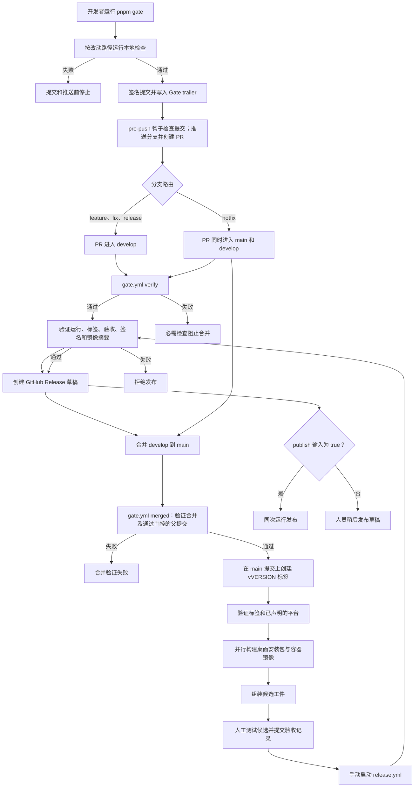

# CI/CD 流水线

本手册是 [CI/CD 流水线（英文）](../ci-cd.md) 的中文版本。它保留 ASD-STE100 的结构规则。中文手册索引见 [README](README.md)。

流水线在两个地方运行。本地工作区检查改动并推送。GitHub 验证工作、构建产物并发布已验收的发行。

流水线有三道门。

1. 本地门控在工作区运行。一条命令检查改动、提交并推送分支。一个本地钩子拒绝绕过该命令的推送。
2. GitHub 门控读取该提交的 trailer。它不重跑任何检查。它接受或拒绝该提交。
3. 构建门控在干净的 runner 上产出产物，并发布已验收的发行。

本手册分两部分。「推送门控」章节说明本地入口和验证器。「合并之后」及其后的章节说明构建与发布。

## 流水线总览



手动启动 `gate.yml` 并设置 `release=true`，可以重跑可发布的候选构建。直接启动 `release-candidate.yml` 可以诊断指定平台，但 `release.yml` 只接受 Gate run ID。发布工作流始终手动启动。

## 推送门控

流水线从本地工作区开始。人在终端运行 `pnpm gate`，按提示填写。自动化直接提供终点阶段和提交标题。

```bash
pnpm gate
pnpm gate --until=pr -m "feat(graph): 添加密度滑块"
```

两种方式都走同一条直线：`plan → check → commit → push → pr → merge`。`--until` 在指定阶段后停止。分支决定目标：普通开发分支进入 `develop`；`hotfix/*` 同时创建面向 `main` 和 `develop` 的 PR；在干净的 `develop` 上运行 gate 会创建面向 `main` 的晋升 PR。晋升沿用已有的合并历史，因此提交和推送阶段会报告无需新提交或直接推送。

在 `release/*` 分支准备版本。gate 接收 `--version`、`--desktop-targets` 和 `--container-platforms`，同步版本文件并在检查前写入平台声明。先将该分支合入 `develop`，再在 `develop` 上运行 gate，使用相同的平台列表创建晋升 PR。每次合并进 `main` 都需要新版本。`main` 的 CI 会创建标签并立即构建候选。

写入发布或热修复版本前，gate 检查新版本高于目标分支版本，且 `origin` 上的 `vVERSION` 尚未占用。晋升时再与 `main` 比较一次。不要提前创建版本标签；由 main 的 CI 在完成验证的提交上创建它。

首次上线需要一次初始化。在受信任的 `main` 提交还没有 `scripts/gate/branches.mjs` 时，在门控变更分支传入 `--base=main`，先让新验证器进入 `main`。随后通过 PR 把门控带入 `develop`。在 `develop` 尚无自己的验证器时，其 CI 读取受保护的 `main` 上的验证器，绝不读取 PR 头部分支的副本。两个分支都有新验证器后，普通开发分支只进入 `develop`。

`plan` 不改动文件。在工作分支上，`check` 阶段暂存工作区并写入 `.gate/last-run.json`；在这里停止时，文件仍处于暂存状态。在 `develop` 上，晋升要求工作区干净，不暂存文件。从 `commit` 阶段起需要标题。每个阶段在进入下一阶段前打印简短结果。

工作流 `gate.yml` 是第二道门。它只回答一个问题。作者是否对本次改动要并入的那棵树使用了本地入口？它不重跑任何检查。

### 门控命令

| 选项 | 作用 |
| --- | --- |
| `--until STAGE` | 在 `plan`、`check`、`commit`、`push`、`pr` 或 `merge` 阶段后停止。 |
| `-m "text"` | 提交标题。从 `commit` 阶段起必填。重复该选项可增加正文段落。 |
| `--base BRANCH` | 确认由当前分支路由选出的目标分支。 |
| `--version VERSION` | 在 `release/*` 或 `hotfix/*` 分支同步版本。 |
| `--desktop-targets LIST` | 在 `release/*` 分支选择桌面目标；在 `develop` 上确认。 |
| `--container-platforms LIST` | 在 `release/*` 分支选择容器平台；在 `develop` 上确认。 |
| `--full` | 运行全部本地检查，而不只是范围内的检查。 |
| `--no-sign` | 不对提交签名。验证器会拒绝未签名的提交。 |
| `--allow-protected` | 允许在 `main` 或 `develop` 上本地运行。 |
| `--no-hooks` | 不安装本地 pre-push 钩子。 |

只有 `--until` 选择停止阶段。`--full` 控制检查范围。

检查失败时命令在提交之前停止。它绝不 force-push。

该命令会提交工作区里的全部改动。请先提交或暂存无关的工作。

命令用 SSH 密钥对提交签名。一次性设置密钥。并把同一把密钥作为签名密钥添加到 GitHub。

```bash
git config --global gpg.format ssh
git config --global user.signingkey ~/.ssh/id_ed25519.pub
git config --global commit.gpgsign true
```

只有当 GitHub 能拦住这次合并时，命令才请 GitHub 合并。
GitHub 会把 auto-merge 请求挂起，直到每一个必需检查通过。
仓库如果没有必需的 `verify` 检查，就立即合并该请求，检查是红的也照合。
这种情况下命令会打印跳过 auto-merge 的原因，并把合并留给你。
受保护路径下的改动永不请求 auto-merge，因为验证器先要标签 `gate-change` 和一次复核。

### 本地刹车

入口需要一个本地仓库里的钩子。该钩子拒绝不是由门控产生的推送。它是机器刹车。权威仍然是作业 `verify`。

```bash
pnpm gate:hooks
```

命令把一个小文件写入 `.git/hooks/pre-push`。该文件调用运行推送的那个检出里的 `scripts/gate/hooks/pre-push`。该文件留在 `.git/hooks`，所以切换分支不会无声地移除刹车。脚本缺失是拒绝，而不是静默跳过。

文件缺失时，命令 `pnpm gate` 会重新安装它。无法安装时，门控在检查之前停止。选项 `--no-hooks` 跳过安装。

钩子做以下判定。

| 推送 | 判定 |
| --- | --- |
| `main` 或 `develop` | 拒绝。受保护分支只能通过 PR 推进。 |
| 分支 | 顶端提交必须通过与作业 `verify` 相同的验证器。 |
| 标签 | 标签必须指向已过门控的提交，或指向合并提交。 |
| 删除 | 接受。 |

钩子用本地 Git 读取顶端提交的签名。没有签名的提交被拒绝。本检出没有签名者名单时，钩子只报告签名，由作业 `verify` 判定。

有两条应急路径。

| 路径 | 作用 |
| --- | --- |
| `git push --no-verify` | Git 跳过全部钩子。 |
| `DBRAIN_GATE_BYPASS=1 git push ...` | 钩子接受全部 ref，并打印警告。 |

两条路径之后，作业 `verify` 依然是红的。刹车只是尽早拦住事故，不替代 GitHub 检查。

### Trailer

门控把一段 trailer 写入提交信息。

```text
Gate-Version: 1
Gate-Tree: 9a1c4f2e...b7
Gate-Checks: release-check,typecheck,lint-gate,unit,build
Gate-Env: node=24.15.0 pnpm=9.0.0 os=linux arch=x64
Gate-Report: sha256:3f9d...21
Gate-Run: 2026-05-05T09:12:44Z
```

`Gate-Tree` 是被检查内容的 Git tree 哈希。trailer 记录的是树，不是提交。因此 rebase 和由编辑器产生的更早提交不会破坏绑定。门控之后内容再变就会破坏绑定。

`Gate-Env` 记录本次运行的工具链。验证器把它抄进报告。

门控把完整报告写入 `.gate/last-run.json`。该文件不入库。

### 检查清单

文件 `scripts/gate/checks.mjs` 保存全部检查。它是唯一真源。

| 检查 | 内容 |
| --- | --- |
| `release-check` | 版本与锁文件一致。 |
| `syntax` | 每个自动化脚本都能解析。 |
| `workflow-lint` | actionlint 接受每个工作流文件。 |
| `repository-yaml` | Dependabot 和 issue template 的 YAML 文件可以解析。 |
| `typecheck` | TypeScript 类型检查器接受整个工作区。 |
| `lint-gate` | 不出现新的 lint 诊断。 |
| `unit` | 发布测试与库测试通过。 |
| `build` | Server 与 Web 应用构建成功。 |
| `smoke-server` | Server 在隔离数据库上应答。 |

每个检查有路径范围。只有改动触及其范围时，门控才运行该检查。选项 `--full` 运行全部检查。

检查 `workflow-lint` 把 actionlint 二进制缓存在 `.gate/tools`。它校验两个固定的 SHA256 值，因此缓存被改就会拒绝。缓存为空时只下载一次发行包。变量 `DBRAIN_GATE_TOOLS` 可以移动缓存位置。

每个检查都在本地门控中运行，每个检查 id 都进入 trailer。清单里没有为干净 runner 准备的检查。产物由发布候选构建并验证。

### 验证器

作业 `verify` 和 `merged` 从可信提交复制门控验证器及其同目录模块，并运行该副本。没有可信验证器时，作业失败。因此改动无法削弱判卷标准。

- 作业 `verify` 读取 PR 的基线提交。
- 作业 `merged` 读取 `main` 或 `develop` 的上一个顶端提交。`develop` 首次拥有验证器之前，两个作业可读取受保护的 main 顶端。

验证器约需 30 秒。它不安装任何依赖。它做以下判定。

1. 头部提交带有 trailer，且协议版本已知。
2. 头部提交的树等于 `Gate-Tree`。
3. trailer 列出改动路径所要求的每一个检查。
4. 没有已跟踪文件落在禁止清单上。禁止清单包含本地 `.env` 文件、依赖、本地数据库、构建产物和密钥文件。
5. 改动 `scripts/gate/**`、`scripts/gate.mjs` 或 `.github/workflows/gate.yml` 需要标签 `gate-change` 和一次复核。标签由 `pnpm gate:policy --apply` 创建。添加或移除该标签会重新运行作业，因此结论跟随标签变化。
6. 提交签名有效。验证器从 GitHub API 读取结果。

被拒绝的提交会让作业失败。ruleset 把作业 `verify` 设为必需状态检查，因此合并被阻止。

在没有 ruleset 的仓库上，该检查无法被设为必需。此时合并不再被自动阻止。请添加标签、等作业通过，然后手工合并。

第 6 条绑定作者身份。签名只能证明一个声明。它不能证明某条命令真的运行过。作者可以写一份假的 trailer。防线是分支 ruleset 和对门控文件的复核。

### 合并门

每个改动都以 merge commit 进入 `main` 或 `develop`。作业 `merged` 读取该提交。晋升 PR 会验证从 `main` 顶端到 `develop` 顶端的每个第一父提交合并。

该提交必须有两个父提交。第一个父提交是 `main` 的上一个顶端提交，它已由更早的一次运行接受。第二个父提交是 PR 的头部。作业对第一个之后的每个父提交做以下判定。

1. 该父提交带有 trailer，且协议版本已知。
2. 该父提交的树等于 `Gate-Tree`。
3. 该提交签名有效。

不是 merge commit 的推送会失败。直接推送到任一受保护分支都无法通过 ruleset。

## 合并之后

| 阶段 | 工作流与作业 | 触发方式 | 产物 |
| --- | --- | --- | --- |
| 校验 | `gate.yml`，作业 `verify` | 面向 `main` 或 `develop` 的 PR | 分支路由和提交的门控结论 |
| 合并 | `gate.yml`，作业 `merged` | 推送到 `main` 或 `develop` | 合并的门控结论 |
| 打标签 | `gate.yml`，作业 `tag` | 推送到 `main` | 该 main 提交的版本标签 |
| 候选 | `gate.yml`，作业 `release` → `release-candidate.yml` | 每次推送到 main | 已声明平台的产物，以及一个候选 |
| 发布 | `release.yml` | 手工启动 | 草稿 Release，或已发布的 Release |

PR 不构建任何产物。每次成功合并到 `main` 都会启动干净机器上的候选构建。

产物构建读取 `scripts/release/release.json` 中的声明。下一节说明该声明。

### 标签

作业 `tag` 在每次推送到 main 时从 `scripts/release/release.json` 读取版本。

- 标签已存在并指向其他提交：作业失败。合并前必须提高版本号。
- 标签已存在并指向当前提交：作业复用标签以重跑候选。
- 标签不存在：作业在被推送的提交上创建 `vVERSION` 并推送该标签。

每次推送到 main，作业 `release` 都会调用 `release-candidate.yml`。手工启动 `gate.yml` 并传入 `release=true` 可以为已存在的标签重复候选构建，例如某个平台构建失败之后。

## 发布候选

`release-candidate.yml` 由 `gate.yml` 的作业 `release` 启动，也可以手工启动。

| 输入 | 含义 | 默认值 |
| --- | --- | --- |
| `tag` | 版本标签，例如 `v0.1.1` | 无 |
| `signed` | 验证 Windows 与 macOS 签名及公证 | `true` |
| `desktop_targets` | 已声明桌面目标中的一部分 | 空 |
| `container_platforms` | 已声明容器平台中的一部分 | 空 |

输入为空时构建整份声明。作业 `verify-tag` 接受或拒绝该标签。它检查以下内容。

1. 发布文件中的版本等于标签。脚本 `scripts/release/check.mjs` 做此判定。
2. 标签所在的提交在默认分支上。

### 已声明的平台

发布由一个文件声明。`scripts/release/release.json` 保存版本和两张平台表。

```json
{
  "version": "0.1.1",
  "desktopTargets": ["linux-x64"],
  "containerPlatforms": ["linux/amd64"]
}
```

gate 根据 `release/*` 分支上的平台参数写入该文件。本地检查验证它，合并到 `develop` 时携带它，main 标签将其固定。候选只构建标签处文件里写的平台。上例只发布 Linux。

脚本 `scripts/release/platforms.mjs` 保存每个平台对应的 runner。该表是全集。声明的名称不在其中时，本地门控和作业 `verify-tag` 都会在 runner 启动之前停止。

输入 `desktop_targets` 与 `container_platforms` 只用于收窄声明，例如某个平台构建失败后的重试。名称不在声明中时会被拒绝。runner 表不包含的名称同样会被拒绝。

候选随后只保存已声明的平台。验收记录也只覆盖这些平台。发布闸门接受这样的候选，因此发布的就是验收记录覆盖的平台。

随后作业 `desktop` 构建已声明的目标。每个矩阵作业的时限为 90 分钟。

| Runner | 目标 |
| --- | --- |
| `ubuntu-22.04` | `linux-x64` |
| `windows-2022` | `win32-x64` |
| `macos-15-intel` | `darwin-x64` |
| `macos-15` | `darwin-arm64` |

每个桌面作业执行以下步骤。

1. 为平台安装 FFmpeg。
2. 恢复 Rust 依赖缓存。
3. 下载固定版本的 PocketBase 二进制。
4. 准备桌面运行时。
5. 运行桌面后端 smoke 测试。
6. 用 `cargo test --locked --release --lib` 运行 Rust 库测试。
7. 用 `pnpm --filter desktop tauri build --ci` 构建安装包。
8. 验证 Linux 包。
9. 用 `codesign` 和 `spctl` 验证 macOS 签名。
10. 用 `Get-AuthenticodeSignature` 验证 Windows 签名。
11. 收集安装包、运行时清单和哈希。
12. 上传制品 `desktop-TARGET-RUN_ID-ATTEMPT`。

步骤 9 和 10 只在输入 `signed` 为 `true` 时运行。

签名构建使用环境 `release`。未签名构建使用环境 `candidate`。签名作业在结束时删除临时签名密钥。

作业 `containers` 构建已声明的架构。

| Runner | 架构 |
| --- | --- |
| `ubuntu-22.04` | amd64 |
| `ubuntu-24.04-arm` | arm64 |

每个矩阵作业的时限为 60 分钟。它构建三个镜像、启动测试容器栈并运行 smoke 客户端。只有 smoke 测试通过后，作业才把镜像推送到 GHCR。

每个作业上传名为 `container-ARCH-RUN_ID-ATTEMPT` 的制品。该制品保存一个架构的 digest 报告。

作业 `merge` 下载每个已声明架构的报告。然后它为每个服务创建一个多架构 digest。最终制品 `containers-RUN_ID-ATTEMPT` 保存 `container-report.json`。

这些作业的环境是 `candidate`。

## 候选组装

作业 `assemble` 等待作业 `desktop` 和 `containers`。它下载同一个 run ID 和同一个 attempt 的制品。随后脚本 `scripts/release/candidate.mjs` 组装候选。该脚本验证以下内容。

- 版本、提交、run ID 和 attempt 在每份报告中一致。
- 每个桌面目标包含预期的安装包格式。
- 每个 `SHA256SUMS` 文件与其目录中的文件匹配。
- 每个容器镜像引用都带 digest。
- 每个镜像的 smoke 测试都通过。

候选制品名为 `candidate-RUN_ID-ATTEMPT`。保留期为 30 天。候选包含以下文件。

| 路径 | 内容 |
| --- | --- |
| `linux-x64/`、`win32-x64/`、`darwin-x64/`、`darwin-arm64/` | 安装包、构建报告、运行时清单、哈希 |
| `containers/container-report.json` | 三个服务、每个已声明架构的镜像 digest |
| `deployment/` | `docker-compose.yml`、`nginx.conf` 和 `.env.example` |
| `candidate-index.json` | 候选身份以及每个文件的 SHA256 |
| `acceptance-template.json` | 空的验收记录 |

不要混用不同 attempt 的制品。失败后请使用「Re-run all jobs」。只重跑一个作业会产生新的 attempt，组装程序会拒绝混用。

## 验收门禁

由人下载候选并测试。然后该人把 `acceptance-template.json` 复制为 `docs/release-acceptance/vVERSION.json`。首次记录时创建该目录。

记录必须包含以下值。

- `reviewer`：非空姓名。
- `reviewedAt`：解析器接受的日期。
- `checks`：每一项状态为 `passed`，且证据至少 10 个字符。
- `thirdPartyMaterials`：公开 HTTPS 地址和 SHA256 值。
- `candidateIndexSha256`：候选索引的哈希。

验收项如下。

| 分组 | 项目 |
| --- | --- |
| 每个桌面目标 | `installation`、`uninstall`、`csp`、`media`、`upgrade`、`process-exit` |
| 产品 | `third-party-materials`、`historical-data-migration`、`backup-restore`、`known-lint-debt` |

门禁拒绝待办项、空证据字段和被改动的候选。值 `candidateIndexSha256` 把记录绑定到一个候选。

## 发布门禁

`release.yml` 只能从默认分支运行。作业使用环境 `release`。

作业按以下顺序验证运行和标签。

1. run ID 是数字。
2. 标签匹配 `vMAJOR.MINOR.PATCH` 模式。
3. 当前 ref 是默认分支。
4. 候选运行是本仓库中 `gate.yml` 的一次成功运行，且在默认分支上。脚本 `scripts/release/validate-run.mjs` 做此判定。
5. 标签所在的提交等于候选运行的 head SHA。
6. head SHA 是当前提交的祖先。
7. 发布文件中的版本等于标签。脚本 `scripts/release/check.mjs` 做此判定。源提交上的版本也等于标签。
8. 所有验收项都通过。脚本 `scripts/release/candidate.mjs approve` 做此判定。
9. `win32-x64`、`darwin-x64` 和 `darwin-arm64` 都有签名且签名已验证的构建。
10. 报告中的每个镜像 digest 都有效。脚本 `scripts/release/verify-images.mjs` 做此判定。

作业拒绝覆盖已存在的 Release。它创建草稿，由人发布该草稿。输入 `publish` 可以在同一次运行中发布 Release。

带后缀的标签（例如 `v0.1.0-rc.1`）创建预发布。

## 仓库策略

门控需要五项仓库设置。脚本 `scripts/gate/apply-ruleset.mjs` 打印计划。加上 `--apply` 时它写入设置。

```bash
pnpm gate:policy
pnpm gate:policy --apply
```

| 设置 | 值 | 原因 |
| --- | --- | --- |
| 自动合并 | 开启 | 本地门控请 GitHub 合并 PR。 |
| 自动合并，实际生效 | 仅当 `verify` 是必需检查 | 没有必需检查时 GitHub 立即合并该请求。此时门控把合并留给你。 |
| 合并方式 | 仅 merge commit | 作业 `merged` 读取 merge commit 的第二个父提交。 |
| 合并后删除源分支 | 关闭 | 热修复分支还要供第二个 PR 使用。 |
| PR | `main` 和 `develop` 必需 | 直接推送无法绕过门控。 |
| 状态检查 | `verify`，来自 GitHub Actions，且分支必须最新 | 合并前必须通过门控。 |
| force-push 与分支删除 | 阻止 | 已门控的提交不能离开历史。 |
| 标签 | `gate-change` 已存在 | 由人添加该标签以批准对门控自身的改动。标签必须先存在，PR 才能带上它。 |

`pnpm gate:policy --apply` 写入这些设置、ruleset 和标签。

所有者需要具备管理员权限的 `gh` 登录。工作流的令牌无法更改 ruleset。

免费套餐下的私有仓库没有 ruleset，也没有分支保护。
GitHub API 此时返回 `403`。
门控会打印计划并报告该拒绝。
升级到 GitHub Pro 或把仓库改为公开之后，请再次应用策略。
在此之前必需检查无法存在，门控也永不请求合并。

此时由本地刹车承担入口。它拒绝直接推送 `main` 或 `develop`、拒绝没有 trailer 的提交、拒绝没有签名的提交。GitHub 报告判定结果，本地机器拒绝推送。

另外两项需要手工完成。

1. 在每个作者账号上注册 SSH 签名密钥。验证器拒绝未签名的提交。
2. 保持 `.github/dependabot.yml` 中的 `open-pull-requests-limit` 为 `0`。bot PR 不携带本地 trailer，验证器会拒绝它。依赖更新通过本地门控进入。

## 安全控制

每个工作流都限制权限。作业 `verify` 和 `merged` 只申请读权限。作业 `tag` 增加 `contents: write` 以推送标签。发布候选增加 `packages: write`。发布作业增加 `contents: write` 以创建 Release。

只读作业的 checkout 步骤不保留凭据。每个 action 步骤使用完整提交 SHA，而不是版本标签。

作业只在推送镜像或读取 digest 时登录 GHCR。作业在结束时登出。

发布作业使用环境 `release`。容器候选作业和未签名桌面作业使用环境 `candidate`。受保护的环境可以保存密钥并要求审批。

## 缓存

| 缓存 | 键的组成部分 | 写入者 |
| --- | --- | --- |
| pnpm store | 操作系统、架构、锁文件 | 使用 `setup-node` 的每个作业 |
| 桌面 Next.js | 操作系统、目标、Node 版本、锁文件 | 仅默认分支 |
| Rust | 目标、签名模式、编译器、锁文件、环境 | 仅默认分支 |
| Docker | 服务与架构 | 仅默认分支 |

发布候选为它构建的每个架构写入 Docker 缓存。PR 不写入缓存。

冷构建会执行每一步。Docker 缓存导出失败不会让构建失败。

## 本地复现流水线

推送门控按顺序运行各阶段。`--until=plan` 只打印检查计划，不暂存文件，也不运行检查。

```bash
pnpm gate --until=plan
```

在仓库根目录运行以下命令。它们用于诊断单个检查。

```bash
pnpm install --frozen-lockfile
pnpm release:check
pnpm check-types
pnpm lint:gate
pnpm test:release
pnpm build
```

容器测试需要隔离的 project。不要使用真实数据。

```bash
export DBRAIN_ADMIN_EMAIL=ci@dbrain.invalid
export DBRAIN_ADMIN_PASSWORD=ci-operator-password
export DBRAIN_IMAGE_PREFIX=dbrain-ci
export DBRAIN_VERSION=test
export DBRAIN_PORT=13080
docker compose -p dbrain-ci -f docker-compose.yml -f deploy/compose.test.yml up --build --wait
export DBRAIN_SMOKE_SERVER_URL=http://127.0.0.1:13081
export DBRAIN_SMOKE_PB_URL=http://127.0.0.1:13090
export DBRAIN_SMOKE_WEB_URL=http://127.0.0.1:13080
export DBRAIN_SMOKE_ADMIN_EMAIL=ci@dbrain.invalid
export DBRAIN_SMOKE_ADMIN_PASSWORD=ci-operator-password
node scripts/release/server-smoke.mjs
docker compose -p dbrain-ci -f docker-compose.yml -f deploy/compose.test.yml down -v
```

smoke 客户端需要宿主机的 FFmpeg。客户端会创建媒体夹具。

文件 `deploy/compose.test.yml` 是 CI 制品。不要在存有重要数据的主机上使用它。

## 手工启动工作流

```bash
gh workflow run gate.yml --ref main -f release=true
gh run list --workflow gate.yml
gh run watch RUN_ID
gh run download RUN_ID --name candidate-RUN_ID-ATTEMPT --dir candidate
gh workflow run release.yml --ref main -f candidate_run_id=RUN_ID -f tag=v0.1.1 -f publish=false
```

手动启动 `gate.yml` 可以重跑现有标签的可发布候选。直接启动 `release-candidate.yml` 可以诊断已声明平台的子集，例如某个平台构建失败后。这次独立运行不能传给 `release.yml`。

```bash
gh workflow run gate.yml --ref main -f release=true
gh workflow run release-candidate.yml --ref main -f tag=v0.1.1 -f signed=true -f desktop_targets=linux-x64 -f container_platforms=linux/amd64
```

## 流水线规则

1. 把可复用逻辑放在 `scripts/release/` 或 `scripts/gate/`，由工作流调用。保持工作流步骤简短。
2. 保持 `scripts/release/check-workflows.sh` 通过。它对每个工作流文件运行 actionlint。
3. 未经审查不要更改触发路径。新的路径过滤会改变他人的作业。
4. 除非任务要求发行，不要启动发布或签名构建。
5. 新增发布门禁时更新 `.github/pull_request_template.md`。
6. 检查清单只放在 `scripts/gate/checks.mjs`。绝不要只把检查加到工作流里。验证器读取基线提交上的清单。
7. 改动 `scripts/gate/**` 需要标签 `gate-change` 和一次复核。没有复核时验证器会拒绝改动判卷标准的提交。
8. 保留 `scripts/gate/hooks/pre-push`。没有 ruleset 的仓库靠它刹车。
9. 在 `scripts/release/release.json` 中声明一次发布的平台。`scripts/release/platforms.mjs` 的 runner 表保存所有存在的名称。测试 `platforms.test.mjs` 做此判定。

## 相关手册

- [开发手册](development.md) 说明环境、质量门禁和维护约定。
- [运维手册](operations.md) 说明镜像部署、备份和恢复。
- [使用手册](usage.md) 说明安装、升级和桌面数据。
- `.github/AGENTS.md` 保存工作流目录的规则。
